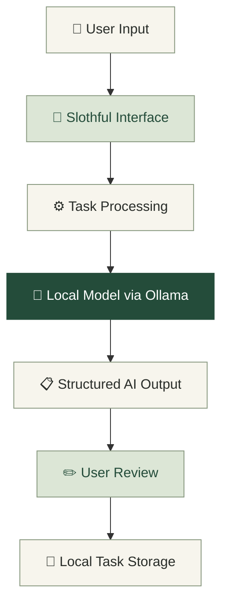

# 🌿 Slothful

### A little less doing. A little more living.

  <strong>Your personal AI companion for doing less unnecessary work.</strong>

  Turn messy thoughts into clear tasks, break overwhelming work into tiny steps, and plan your day at your own pace.

  
  
  
  

  <em>Inspired by the belief that productivity should make life easier, not busier.</em>

---

## What is Slothful?

We all have unfinished tasks, scattered notes, overwhelming deadlines, and responsibilities we keep putting off.

Sometimes, the hardest part isn't doing the work. It's figuring out where to start.

**Slothful** is an AI-powered productivity companion built to reduce that mental load.

Instead of filling your day with endless tasks and reminders, Slothful helps you focus on what matters, take manageable steps, and work at a sustainable pace.

Dump your thoughts.  
Find your next step.  
Leave some room to breathe.

Built for the **Slow and Steady** open-source AI challenge.

---

## Features

<table>
  <tr>
    <td width="50%">
      <h3>🧠 Brain Dump</h3>
      
Get everything out of your head. Transform unstructured thoughts into organized, actionable tasks with AI assistance.

    </td>
    <td width="50%">
      <h3>📋 Smart Task Manager</h3>
      
Create, organize, prioritize, search, and complete tasks without unnecessary complexity.

    </td>
  </tr>
  <tr>
    <td width="50%">
      <h3>Gentle Plan</h3>
      
Build a realistic daily plan based on your energy, available time, priorities, and estimated effort.

    </td>
    <td width="50%">
      <h3>Make It Easier</h3>
      
Break intimidating responsibilities into small, approachable actions. Start with one manageable step.

    </td>
  </tr>
  <tr>
    <td width="50%">
      <h3>Quiet Inbox</h3>
      
Summarize notes, extract key takeaways, and turn useful information into actionable tasks.

    </td>
    <td width="50%">
      <h3>Local-First AI</h3>
      
Use compatible open-weight models through Ollama to process supported content locally on your own machine.

    </td>
  </tr>
</table>

### Make It Easier: A Tiny Example

**The overwhelming task:**

> Prepare my project presentation.

**The Slothful approach:**

- [ ] Open the existing project notes.
- [ ] Write down three main points.
- [ ] Create the title slide.
- [ ] Add the problem statement.
- [ ] Review what is already done.

You don't have to finish everything right now. You just need a place to start.

---

## A Calm, Thoughtful Experience

Slothful follows a warm, premium, minimalist design philosophy.

- Warm ivory backgrounds and forest-green accents
- Soft sage details and natural visual elements
- Refined typography and clear information hierarchy
- Distraction-free layouts and gentle interactions
- Responsive design for desktop, tablet, and mobile

No overwhelming dashboards. No unnecessary productivity pressure. Just a calmer way to organize everyday life.

> The goal isn't to do everything. It's to make the important things easier.

---

## Powered by Open-Source AI

Open innovation is at the heart of Slothful.

The application is designed to use compatible open-weight language models through [Ollama](https://ollama.com/).

### Why open-weight AI?

| Advantage | What it means for Slothful |
|---|---|
| Privacy | Local inference can keep supported notes and tasks on your machine. |
| Flexibility | Configure compatible models without redesigning the whole application. |
| Customization | Adapt prompts and task-planning behavior to your needs. |
| Fewer API costs | Local inference avoids mandatory paid AI API calls. |
| Offline potential | Local inference can work without internet after the necessary models and dependencies are installed. |

### 🔄 How it works

*Illustrative architecture. Actual processing and storage depend on the configured implementation.*

### 🛡️ Privacy by Design

- Task data is intended to remain local by default.
- AI requests go to the configured model endpoint.
- A local Ollama endpoint can process supported content on your machine.
- Users should be able to export their data and clear locally stored information.
- Demo mode provides a fallback when a model is unavailable.

Local inference is not automatically a guarantee of complete offline operation. Initial downloads, application dependencies, and endpoint configuration may require additional setup.

---

## 🛠️ Tech Stack

| Technology | Purpose |
|---|---|
| ⚛️ React | User interface |
| 📘 TypeScript | Type safety |
| ⚡ Vite | Frontend development and builds |
| 🎨 Tailwind CSS | Styling and responsive layouts |
| 🖼️ Lucide | Consistent interface icons |
| 🐍 FastAPI | Optional AI backend |
| 🦙 Ollama | Local model inference |
| 💾 IndexedDB / local storage | Local persistence |

*This table describes the intended architecture. Retain only technologies actually implemented in your repository.*

### Start organizing your day

1. Open Slothful.
2. Add a task or submit a brain dump.
3. Review the suggested tasks.
4. Build a Gentle Plan.
5. Use Make It Easier to break down a difficult task.
6. Connect Ollama to enable local model inference.

If Ollama is unavailable, use the application's supported fallback mode.

## 🤝 Contributing

Contributions, ideas, and thoughtful improvements are welcome.

1. Fork the repository.
2. Create a feature branch.
3. Make your changes.
4. Run the available tests.
5. Open a pull request describing the changes.

Please keep contributions aligned with Slothful's core principles:

- Calm, accessible design
- Privacy-conscious defaults
- Meaningful open-source AI integration
- Reliable functionality
- Minimal unnecessary complexity

---

## 🔐 Privacy and Security

Slothful is designed around local-first data handling.

Before using the application with sensitive information, verify your configured inference endpoint and storage behavior.

- Never commit secrets or private environment files.
- Validate imported files and model-generated responses.
- Avoid logging personal notes unnecessarily.
- Review the license of each model and dependency.
- Do not assume all model weights permit unrestricted redistribution or commercial use.

---

## 🌱 The Slow and Steady Philosophy

Slothful was inspired by the idea that doing things at a sustainable pace is better than constantly feeling behind.

Open-weight AI can help remove repetitive mental work while giving users more control over the tools they use.

A brain dump becomes a plan. A big task becomes a small step. A busy day becomes a little more manageable.

No pressure to optimize every second.

No need to do everything at once.

Just a little less doing, and a little more living.

---

  <strong>🌿 Slothful</strong>
   
  <em>A little less doing. A little more living.</em>
    
  Built with care for the <strong>Slow and Steady</strong> challenge.

